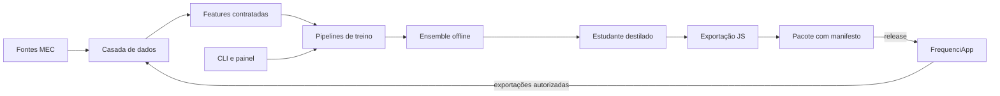

# FrequencIA

[](https://github.com/eemtijca/frequencia/actions/workflows/qualidade.yml)
[](https://github.com/eemtijca/frequencia/actions/workflows/testes.yml)
[](https://github.com/eemtijca/frequencia/actions/workflows/build.yml)
[](https://github.com/eemtijca/frequencia/actions/workflows/codeql.yml)
[](LICENSE)

Motor científico do FrequenciApp: treina, avalia, empacota e publica modelos leves de risco de infrequência escolar para inferência local no navegador. Mobile-first, sem ruído e com privacidade por padrão, herdando o estilo e as convenções do [FrequenciApp](https://github.com/eemtijca/frequenciapp).

O primeiro modelo estima, para cada estudante, a probabilidade de acumular pelo menos duas faltas nos próximos sete dias letivos. A previsão vira um indicador de apoio no painel da coordenação: nunca uma decisão automática, sempre sujeita a revisão humana. O artefato publicado é um arquivo JavaScript puro de poucos kilobytes, com calibração, intervalos de confiança, estados de confiança e histerese embutidos, que roda inteiramente no PWA, offline, em celular modesto.

<details>
<summary>Sumário</summary>

- [Recursos](#recursos)
- [Stack](#stack)
- [Pré-requisitos](#pré-requisitos)
- [Começando](#começando)
- [Como usar](#como-usar)
- [Arquitetura](#arquitetura)
- [Testes e qualidade](#testes-e-qualidade)
- [Execução com Docker](#execução-com-docker)
- [Privacidade](#privacidade)
- [Segurança](#segurança)
- [Documentação](#documentação)
- [Governança](#governança)
- [Contribuindo](#contribuindo)
- [Suporte](#suporte)
- [Créditos](#créditos)
- [Licença](#licença)

</details>

## Recursos

- **Dados sintéticos coerentes**: gerador determinístico que simula a estrutura relacional do FrequenciApp (séries, turmas, alunos, chamadas, faltas, saídas, entradas, feriados), com sazonalidade escolar, perfis de recursos por escola, transferências, correções retroativas de chamada e verdade oculta por aluno para avaliação de risco.
- **Catálogo de features como contrato**: 47 features documentadas com nome, tipo, janela, origem, dependência de configuração e valor padrão; ordinais de justificativa com códigos raros agrupados e texto livre fora do modelo.
- **Dataset temporal sem vazamento**: unidade aluno-dia com rótulo futuro de sete dias letivos, features materializadas como snapshot ponto-in-tempo (correções retroativas não contaminam o passado) e separação treino, validação e teste por tempo com purga do horizonte.
- **Ensemble offline, modelo leve publicado**: sete membros de base (LightGBM curto e médio, XGBoost, CatBoost, histogramas do scikit-learn, regressão logística e baseline de regras) combinados por regressão logística sobre previsões fora da dobra; a destilação entrega um estudante LightGBM de profundidade três que cabe no navegador.
- **Confiança estatística completa**: calibração de Platt regularizada em direção à identidade, encolhimento para a taxa base no primeiro mês, predição conforme Mondrian por série e faixa de histórico, curva de aprendizado por volume de histórico e discordância entre membros como incerteza.
- **Inferência local com fallback**: pacote zip com modelo.js, fallback.js de regras espelhadas, manifest.json de compatibilidade, dados-teste.json para autoverificação e modelo-cartao.md; o app lê o manifesto, decide compatibilidade e nunca carrega modelo novo durante a chamada.
- **CLI completa**: doze grupos funcionais cobrindo o ciclo de dados a auditoria, com modo seco, saída JSON, idempotência por etapa e força apenas com justificativa registrada.
- **Painel de governança**: dezesseis páginas Streamlit sobre o mesmo motor da CLI, com papéis, tarefas de fundo, promoção com checklist e confirmação dupla para publicar, reverter e revogar.
- **Governança auditável**: registro de modelos com estados e aprovações, trilha de auditoria em acréscimo, logs estruturados sem dados de alunos, portão de privacidade que bloqueia dataset com PII antes do treino.
- **Erros em português**: toda falha da CLI vira frase curta e acionável, sem termo técnico nem stack trace para quem não é da engenharia.

## Stack

- Python 3.12 com tipagem estática (mypy) e lint/formato com ruff.
- polars 2.0 para dados e janelas temporais; pandas 3.0 onde as bibliotecas exigem.
- pandera 0.34 validando os esquemas das onze tabelas do domínio.
- LightGBM 4.7 como modelo destilado; XGBoost 3.4, CatBoost 1.2 e scikit-learn 1.9 no ensemble; Optuna 5 opcional.
- MLflow 3.17 com backend SQLite local para rastreamento; DVC 3.67 versionando dados em modo sem Git.
- m2cgen 0.10 transpilando o estudante para JavaScript puro; onnxmltools e skl2onnx como caminho alternativo documentado.
- typer 0.27 para a CLI; Streamlit 1.66 para o painel; presidio-analyzer 2.2 em modo padrão reforçado com regras próprias de português.
- pytest 9 e Hypothesis 6 para a suíte de testes.

## Pré-requisitos

- Python 3.12 e Node.js 20 ou superior (o Node executa o teste de paridade do modelo.js).
- Docker com Compose no modo recomendado, ou venv puro para a execução direta.

## Começando

Caminho venv, validado ponta a ponta:

```bash
bash scripts/setup.sh        # cria o .venv com Python 3.12 e dependências pinadas
bash scripts/smoke.sh        # gera dados, constrói dataset, treina, exporta, valida paridade e roda a suíte
bash scripts/demo.sh         # sobe o painel de governança em http://localhost:8501
```

O smoke test gera dados sintéticos, executa o ciclo completo do experimento (treino, ensemble, calibração, destilação, avaliação, exportação e empacotamento), confere os gates de promoção, valida a paridade entre a previsão Python e a JavaScript e roda os 68 testes automatizados. Tudo em poucos minutos numa máquina comum.

## Como usar

1. Gere ou importe dados: `frequencia dados gerar-sintetico --perfil fumaca`.
2. Passe pelo portão de privacidade: `frequencia privacidade validar-entrada-treino <pasta>`.
3. Construa o dataset temporal: `frequencia datasets construir <pasta> --versao v1`.
4. Execute o ciclo completo: `frequencia experimentos executar <dataset> --identificador exp1`.
5. Confira os gates: `frequencia avaliacao validar-gates var/artefatos/experimentos/exp1`.
6. Promova e publique com o papel de aprovador: `frequencia publicacao publicar var/pacotes/risco-infrequencia-<versao> <versao>`.
7. Entregue o zip de `var/pacotes/` ao FrequenciApp: ele lê o manifesto e decide.

Os detalhes de cada comando estão em `frequencia <grupo> --help`, e o passo a passo com interface em [INSTRUCOES.md](INSTRUCOES.md).

## Arquitetura

Uma arvore em camadas com dependência apontando para dentro: infraestrutura transversal, dados, privacidade, features, pipelines, modelos, distribuição, monitoramento e integração, expostos pela CLI e pelo painel web. O TabFM do Google Research orienta os princípios de ensemble, calibração, limites explícitos e separação entre configuração e artefato, sem incorporar runtime nem pesos.



As camadas, o fluxo completo e o mapeamento entre responsabilidades e pastas estão em [docs/arquitetura.md](docs/arquitetura.md).

## Testes e qualidade

| Comando | Efeito |
| --- | --- |
| `bash scripts/smoke.sh` | Ciclo completo mais suíte de testes com dados sintéticos. |
| `make test` | Suíte pytest com 68 testes, incluindo paridade Python e Node. |
| `make lint` | ruff no código-fonte e nos testes. |
| `make tipo` | mypy nos módulos do pacote. |
| `make formato-check` | Confere a formatação sem alterar arquivos. |
| `make dicionario` | Regenera o dicionário de features. |
| `make etiquetas` | Sincroniza as etiquetas do GitHub com o catálogo. |

A convenção das suítes está em [docs/testes.md](docs/testes.md) e a guarda editorial roda junto da suíte, herdando o padrão de texto do FrequenciApp.

## Execução com Docker

```bash
cp .env.example .env
docker compose up --build        # sobe MLflow (5000) e o painel (8501)
docker compose --profile ciclo up smoke   # roda o smoke test dentro do contêiner
```

O caminho Docker é construído e validado no CI: o workflow `testes.yml` sobe o MLflow e o painel, confere a saúde dos dois serviços e executa o ciclo completo no container. A imagem de runtime é a usada pelo painel e pelo MLflow; a imagem de desenvolvimento, com Node 20 e testes, roda o smoke. O caminho venv continua sendo o mais rápido para o desenvolvimento local. Detalhes em [INSTRUCOES.md](INSTRUCOES.md).

## Privacidade

Dados pessoais reais de alunos não entram no repositório, nos artefatos, nos logs nem nos pacotes. O gerador sintético é determinístico e sem pessoas reais; o portão de privacidade bloqueia dataset com PII detectada antes do treino; a inferência publicada roda no navegador e não envia nada a servidores. Detalhes e papéis da LGPD em [docs/privacidade-lgpd.md](docs/privacidade-lgpd.md).

## Segurança

Vulnerabilidades são reportadas em canal privado, nunca em issue pública. Use o [advisory privado do GitHub](https://github.com/eemtijca/frequencia/security/advisories/new) ou o canal indicado no perfil do repositório. A pipeline valida esquemas antes de qualquer ingestão, registra hash e licença de cada importação e traduz toda falha para português claro. O repositório usa CodeQL, secret scanning e Dependabot com security updates. A política completa está em [SECURITY.md](SECURITY.md).

## Documentação

| Documento | Conteúdo |
| --- | --- |
| [INSTRUCOES.md](INSTRUCOES.md) | Como executar o ciclo em venv e Docker e navegar pelas interfaces. |
| [docs/arquitetura.md](docs/arquitetura.md) | Camadas, fluxo de dados e decisões registradas. |
| [docs/modelo-de-dados.md](docs/modelo-de-dados.md) | Esquema sintético e mapeamento com o FrequenciApp. |
| [docs/catalogo-de-modelos.md](docs/catalogo-de-modelos.md) | Modelos, estados e o projeto de risco de infrequência. |
| [docs/dicionario-de-features.md](docs/dicionario-de-features.md) | As 47 features do contrato com semântica completa. |
| [docs/contrato-de-inferencia.md](docs/contrato-de-inferencia.md) | Entrada, saída e casos de teste da inferência no navegador. |
| [docs/contrato-de-manifesto.md](docs/contrato-de-manifesto.md) | Campos do manifest.json lido pelo app. |
| [docs/mlops.md](docs/mlops.md) | Como treinar, avaliar, calibrar e publicar. |
| [docs/privacidade-lgpd.md](docs/privacidade-lgpd.md) | Dados tratados, bases legais e direitos do titular. |
| [docs/integracao-frequenciapp.md](docs/integracao-frequenciapp.md) | Mapa de features, feature flags e vocabulário aprovado. |
| [docs/releases.md](docs/releases.md) | Política de versões, tags, artefatos e suporte. |
| [docs/adr/](docs/adr/) | Decisões de arquitetura registradas. |

## Governança

O projeto segue o modelo de governança do FrequenciApp, adaptado ao stack Python e ao ciclo de MLOps:

- [CONTRIBUTING.md](CONTRIBUTING.md): issues, etiquetas, branches, commits, pull requests, testes, documentação e releases.
- [CODE_OF_CONDUCT.md](CODE_OF_CONDUCT.md): norma de convivência da comunidade.
- [SECURITY.md](SECURITY.md): canal privado, práticas adotadas e limitações.
- [AGENTS.md](AGENTS.md): regras para agentes de IA e para o fluxo de mudanças.
- [docs/releases.md](docs/releases.md): versionamento, tags e artefatos publicados.
- [docs/adr/](docs/adr/): decisões de arquitetura registradas.

A `main` é protegida por rulesets: pull request obrigatório, checks verdes, revisão de CODEOWNERS, conversas resolvidas e squash. As tags `v*` são imutáveis.

## Contribuindo

Leia o [CONTRIBUTING.md](CONTRIBUTING.md) antes de propor mudanças. Toda issue e todo pull request recebem etiqueta de tipo e de área; o catálogo fica em `.github/labels.json` e é sincronizado com `make etiquetas`. Commits seguem Conventional Commits em português, a guarda editorial reprova travessão, aspas curvas e setas, e decisões estruturais ganham ADR. Agentes de IA seguem o [AGENTS.md](AGENTS.md).

## Suporte

Dúvidas e problemas são bem-vindos nas issues do repositório. A triagem acontece em até 7 dias. Para vulnerabilidades, use o canal privado descrito no [SECURITY.md](SECURITY.md); para conduta, o [CODE_OF_CONDUCT.md](CODE_OF_CONDUCT.md).

## Créditos

Projeto mantido pela equipe do FrequencIA, com referências de engenharia ao FrequenciApp e ao TabFM (Google Research) como inspiração arquitetural documentada em ADR.

## Licença

[MIT](LICENSE)
