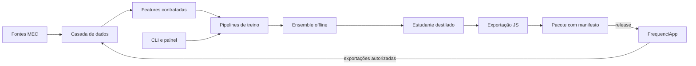

# FrequencIA

[](https://github.com/eemtijca/frequencia/actions/workflows/qualidade.yml)
[](https://github.com/eemtijca/frequencia/actions/workflows/testes.yml)
[](https://github.com/eemtijca/frequencia/actions/workflows/build.yml)
[](https://github.com/eemtijca/frequencia/actions/workflows/codeql.yml)
[](LICENSE)

Motor científico do FrequenciApp: treina, avalia, empacota e publica modelos leves de risco de infrequência escolar para inferência local no navegador. Mobile-first, sem ruído e com privacidade por padrão, herdando o estilo e as convenções do [FrequenciApp](https://github.com/eemtijca/frequenciapp).

O primeiro modelo estima, para cada estudante, a probabilidade de acumular pelo menos duas faltas nos próximos sete dias letivos. A previsão vira um indicador de apoio no painel da coordenação: nunca uma decisão automática, sempre sujeita a revisão humana. O artefato publicado é um arquivo JavaScript puro de poucos kilobytes, com calibração, intervalos de confiança, estados de confiança e histerese embutidos, que roda inteiramente no PWA, offline, em celular modesto.

## Começando em 5 minutos

### Pré-requisitos

- Docker com Compose v2.
- Git.
- Cerca de 2 GB de espaço livre.

Python 3.12 e Node.js 20 ou superior são necessários apenas no caminho venv de fallback. O host com Python 3.15 não é suportado.

### Suba o ambiente

```bash
git clone https://github.com/eemtijca/frequencia.git
cd frequencia
docker compose up --build -d
docker compose ps
```

O painel fica em http://localhost:8501 e o MLflow em http://localhost:5000. Aguarde os serviços aparecerem como `healthy`.

### Valide o ciclo completo

```bash
docker compose --profile ciclo up smoke
```

A saída termina com `Smoke test concluído com sucesso`. A primeira execução baixa dependências e pode demorar alguns minutos.

### Rode o ciclo pela CLI

```bash
# 1. Gere dados sintéticos
docker compose --profile cli run --rm cli frequencia dados gerar-sintetico \
  --perfil fumaca \
  --destino var/dados/sinteticos/demo \
  --semente 20261018

# 2. Passe pelo portão de privacidade
docker compose --profile cli run --rm cli frequencia privacidade validar-entrada-treino \
  var/dados/sinteticos/demo

# 3. Construa o dataset temporal
docker compose --profile cli run --rm cli frequencia datasets construir \
  var/dados/sinteticos/demo \
  --versao demo \
  --ponto-no-tempo estrito

# 4. Execute o ciclo completo
docker compose --profile cli run --rm cli frequencia experimentos executar \
  var/dados/processados/demo \
  --identificador demo \
  --versao-modelo 2026.10.20-demo

# 5. Confira os gates
docker compose --profile cli run --rm cli frequencia avaliacao validar-gates \
  var/artefatos/experimentos/demo
```

### Veja os artefatos

```bash
docker compose --profile cli run --rm -T --no-deps cli ls -la var/artefatos/experimentos/demo
docker compose --profile cli run --rm -T --no-deps cli ls -la var/pacotes
```

### Pare o ambiente

```bash
docker compose down
```

O comando preserva o volume `dados`. Para remover também os dados do volume, use com cuidado:

```bash
docker compose down -v
```

### Fallback com venv

Use apenas quando Docker não estiver disponível e houver Python 3.12.

```bash
python3.12 --version
bash scripts/setup.sh
source .venv/bin/activate
bash scripts/smoke.sh
```

O volume `dados` do Docker é separado do `var/` local do venv. Escolha um caminho e registre qual foi usado.

## Perfis de uso

| Perfil | Comece por |
| --- | --- |
| Quero ver o painel | Suba o ambiente com Docker e abra http://localhost:8501 |
| Quero rodar o ciclo | Use o smoke acima ou o ciclo pela CLI |
| Quero desenvolver | [CONTRIBUTING.md](CONTRIBUTING.md) e [AGENTS.md](AGENTS.md) |
| Quero operar com um agente | [.agents/skills/frequencia/SKILL.md](.agents/skills/frequencia/SKILL.md) |
| Quero pesquisar e inovar | [docs/ciencia-e-inovacao.md](docs/ciencia-e-inovacao.md) |

## Recursos

- **Dados sintéticos coerentes**: gerador determinístico que simula a estrutura relacional do FrequenciApp (séries, turmas, alunos, chamadas, faltas, saídas, entradas, feriados), com sazonalidade escolar, perfis de recursos por escola, transferências, correções retroativas de chamada e verdade oculta por aluno para avaliação de risco.
- **Catálogo de features como contrato**: 47 features documentadas com nome, tipo, janela, origem, dependência de configuração e valor padrão; ordinais de justificativa com códigos raros agrupados e texto livre fora do modelo.
- **Dataset temporal sem vazamento**: unidade aluno-dia com rótulo futuro de sete dias letivos, features materializadas como snapshot ponto-in-tempo (correções retroativas não contaminam o passado) e separação treino, validação e teste por tempo com purga do horizonte.
- **Ensemble offline, modelo leve publicado**: sete membros de base (LightGBM curto e médio, XGBoost, CatBoost, histogramas do scikit-learn, regressão logística e baseline de regras) combinados por regressão logística sobre previsões fora da dobra; a destilação entrega um estudante LightGBM de profundidade três que cabe no navegador.
- **Confiança estatística completa**: calibração de Platt regularizada em direção à identidade, encolhimento para a taxa base no primeiro mês, predição conforme Mondrian por série e faixa de histórico, curva de aprendizado por volume de histórico e discordância entre membros como incerteza.
- **Inferência local com fallback**: pacote zip com modelo.js, fallback.js de regras espelhadas, manifest.json de compatibilidade, dados-teste.json para autoverificação e modelo-cartao.md; o app lê o manifesto, decide compatibilidade e nunca carrega modelo novo durante a chamada.
- **CLI completa**: doze grupos funcionais cobrindo o ciclo de dados a auditoria, com modo seco, saída JSON, idempotência por etapa e força apenas com justificativa registrada.
- **Painel de governança**: dezesseis páginas Streamlit sobre o mesmo motor da CLI, com papéis, tarefas de fundo, promoção com checklist e confirmação dupla para publicar, reverter e revogar.
- **Governança auditável**: registro de modelos com estados e aprovações, trilha de auditoria em acréscimo, logs estruturados sem dados de alunos, portão de privacidade que bloqueia dataset com PII antes do treino.
- **Erros em português**: toda falha da CLI vira frase curta e acionável, sem termo técnico nem stack trace para quem não é da engenharia.

## Stack

- Python 3.12 com tipagem estática (mypy) e lint/formato com ruff.
- polars 2.0 para dados e janelas temporais; pandas 3.0 onde as bibliotecas exigem.
- pandera 0.34 validando os esquemas das onze tabelas do domínio.
- LightGBM 4.7 como modelo destilado; XGBoost 3.4, CatBoost 1.2 e scikit-learn 1.9 no ensemble; Optuna 5 opcional.
- MLflow 3.17 com backend SQLite local para rastreamento; DVC 3.67 versionando dados em modo sem Git.
- m2cgen 0.10 transpilando o estudante para JavaScript puro; onnxmltools e skl2onnx como caminho alternativo documentado.
- typer 0.27 para a CLI; Streamlit 1.66 para o painel; presidio-analyzer 2.2 em modo padrão reforçado com regras próprias de português.
- pytest 9 e Hypothesis 6 para a suíte de testes.

## Serviços do Compose

| Serviço | Papel | Porta |
| --- | --- | --- |
| `mlflow` | servidor de rastreamento com SQLite em volume | 5000 |
| `app` | painel Streamlit de governança | 8501 |
| `cli` | comandos pontuais na imagem de desenvolvimento | sem porta |
| `smoke` | ciclo completo na imagem de desenvolvimento | sem porta |

O volume `dados` compartilha `var/` entre os serviços. Experimento feito na CLI aparece no painel e no smoke.

## Como usar

O ciclo completo está descrito em [INSTRUCOES.md](INSTRUCOES.md). Os comandos essenciais:

```bash
# Ajuda geral e por grupo
docker compose --profile cli run --rm -T --no-deps cli frequencia --help
docker compose --profile cli run --rm -T --no-deps cli frequencia experimentos --help

# Ciclo mínimo
docker compose --profile cli run --rm cli frequencia dados gerar-sintetico \
  --perfil fumaca

docker compose --profile cli run --rm cli frequencia privacidade validar-entrada-treino \
  var/dados/sinteticos/perfil-fumaca

docker compose --profile cli run --rm cli frequencia datasets construir \
  var/dados/sinteticos/perfil-fumaca \
  --versao v1

docker compose --profile cli run --rm cli frequencia experimentos executar \
  var/dados/processados/v1 \
  --identificador exp1

docker compose --profile cli run --rm cli frequencia avaliacao validar-gates \
  var/artefatos/experimentos/exp1
```

Promoção e publicação exigem uma pessoa aprovadora:

```bash
docker compose --profile cli run --rm cli frequencia registro aprovar \
  risco-infrequencia <versao> \
  --comentario "gates e documentação revisados" \
  --ator <pessoa> \
  --papel aprovador

docker compose --profile cli run --rm cli frequencia registro promover \
  risco-infrequencia <versao> \
  --estado candidato \
  --justificativa "gates aprovados" \
  --ator <pessoa> \
  --papel aprovador

docker compose --profile cli run --rm cli frequencia registro promover \
  risco-infrequencia <versao> \
  --estado homologado \
  --justificativa "revisão concluída" \
  --ator <pessoa> \
  --papel aprovador

docker compose --profile cli run --rm cli frequencia publicacao publicar \
  var/pacotes/risco-infrequencia-<versao> \
  <versao> \
  --notas "o que mudou para a escola" \
  --ator <pessoa> \
  --papel aprovador
```

## Arquitetura

Uma árvore em camadas com dependência apontando para dentro: infraestrutura transversal, dados, privacidade, features, pipelines, modelos, distribuição, monitoramento e integração, expostos pela CLI e pelo painel web. O TabFM do Google Research orienta os princípios de ensemble, calibração, limites explícitos e separação entre configuração e artefato, sem incorporar runtime nem pesos.



As camadas, o fluxo completo e o mapeamento entre responsabilidades e pastas estão em [docs/arquitetura.md](docs/arquitetura.md).

## Testes e qualidade

Os alvos do Makefile usam Docker por padrão. Os alvos `venv-*` são fallback com Python 3.12.

```bash
# Docker
make formato-check
make lint
make tipo
make test
make smoke

# Fallback venv
make venv-formato-check
make venv-lint
make venv-tipo
make venv-test
make venv-smoke
```

Equivalentes diretos:

```bash
docker compose --profile cli run --rm -T --no-deps cli ruff format --check src tests
docker compose --profile cli run --rm -T --no-deps cli ruff check src tests
docker compose --profile cli run --rm -T --no-deps cli mypy src/frequencia
docker compose --profile cli run --rm -T --no-deps cli python -m pytest tests -q
docker compose --profile ciclo up smoke
```

A convenção das suítes está em [docs/testes.md](docs/testes.md) e a guarda editorial roda junto da suíte, herdando o padrão de texto do FrequenciApp.

## Privacidade

Dados pessoais reais de alunos não entram no repositório, nos artefatos, nos logs nem nos pacotes. O gerador sintético é determinístico e sem pessoas reais; o portão de privacidade bloqueia dataset com PII detectada antes do treino; a inferência publicada roda no navegador e não envia nada a servidores. Detalhes e papéis da LGPD em [docs/privacidade-lgpd.md](docs/privacidade-lgpd.md).

## Documentação

| Documento | Conteúdo |
| --- | --- |
| [INSTRUCOES.md](INSTRUCOES.md) | Como executar o ciclo em Docker e no fallback venv. |
| [docs/arquitetura.md](docs/arquitetura.md) | Camadas, fluxo de dados e decisões registradas. |
| [docs/modelo-de-dados.md](docs/modelo-de-dados.md) | Esquema sintético e mapeamento com o FrequenciApp. |
| [docs/catalogo-de-modelos.md](docs/catalogo-de-modelos.md) | Modelos, estados e o projeto de risco de infrequência. |
| [docs/dicionario-de-features.md](docs/dicionario-de-features.md) | As 47 features do contrato com semântica completa. |
| [docs/contrato-de-inferencia.md](docs/contrato-de-inferencia.md) | Entrada, saída e casos de teste da inferência no navegador. |
| [docs/contrato-de-manifesto.md](docs/contrato-de-manifesto.md) | Campos do manifest.json lido pelo app. |
| [docs/mlops.md](docs/mlops.md) | Como treinar, avaliar, calibrar e publicar. |
| [docs/publicacao-de-modelos.md](docs/publicacao-de-modelos.md) | Gates, promoção, release, rollback e revogação. |
| [docs/retreinamento-e-recalibracao.md](docs/retreinamento-e-recalibracao.md) | Sinais, cadência e procedimentos de reanálise. |
| [docs/runbooks.md](docs/runbooks.md) | Procedimentos operacionais passo a passo. |
| [docs/testes.md](docs/testes.md) | Suítes, convenções e cobertura. |
| [docs/ciencia-e-inovacao.md](docs/ciencia-e-inovacao.md) | Método científico, funil de inovação e critérios de decisão. |
| [docs/templates/](docs/templates/) | Brief, protocolo, nota de pesquisa, revisão, rubrica e pacote de evidências. |
| [docs/guia-do-cientista.md](docs/guia-do-cientista.md) | Guia humano do time de ML e ciência de dados. |
| [docs/guia-da-coordenacao.md](docs/guia-da-coordenacao.md) | Guia humano de uso do indicador na escola. |
| [docs/privacidade-lgpd.md](docs/privacidade-lgpd.md) | Dados tratados, bases legais e direitos do titular. |
| [docs/integracao-frequenciapp.md](docs/integracao-frequenciapp.md) | Mapa de features, feature flags e vocabulário aprovado. |
| [docs/releases.md](docs/releases.md) | Política de versões, tags, artefatos e suporte. |
| [docs/adr/](docs/adr/) | Decisões de arquitetura registradas. |

## Governança

O projeto segue o modelo de governança do FrequenciApp, adaptado ao stack Python e ao ciclo de MLOps:

- [CONTRIBUTING.md](CONTRIBUTING.md): issues, etiquetas, branches, commits, pull requests, testes, documentação e releases.
- [CODE_OF_CONDUCT.md](CODE_OF_CONDUCT.md): norma de convivência da comunidade.
- [SECURITY.md](SECURITY.md): canal privado, práticas adotadas e limitações.
- [AGENTS.md](AGENTS.md): regras para agentes de IA no desenvolvimento.
- [.agents/skills/frequencia/SKILL.md](.agents/skills/frequencia/SKILL.md): manual operacional para agentes de IA.
- [docs/ciencia-e-inovacao.md](docs/ciencia-e-inovacao.md): diretrizes de ciência e inovação.
- [docs/guia-do-cientista.md](docs/guia-do-cientista.md) e [docs/guia-da-coordenacao.md](docs/guia-da-coordenacao.md): guias humanos do time técnico e da escola.
- [docs/releases.md](docs/releases.md): versionamento, tags e artefatos publicados.
- [docs/adr/](docs/adr/): decisões de arquitetura registradas.

A `main` é protegida por rulesets: pull request obrigatório, checks verdes, revisão de CODEOWNERS, conversas resolvidas e squash. As tags `v*` são imutáveis.

## Contribuindo

Leia o [CONTRIBUTING.md](CONTRIBUTING.md) antes de propor mudanças. Toda issue e todo pull request recebem etiqueta de tipo e de área; o catálogo fica em `.github/labels.json` e é sincronizado com `make etiquetas`. Commits seguem Conventional Commits em português, a guarda editorial reprova travessão, aspas curvas e setas, e decisões estruturais ganham ADR. Agentes de IA seguem o [AGENTS.md](AGENTS.md) no desenvolvimento e o [SKILL.md](.agents/skills/frequencia/SKILL.md) na operação.

## Suporte

Dúvidas e problemas são bem-vindos nas issues do repositório. A triagem acontece em até 7 dias. Para vulnerabilidades, use o canal privado descrito no [SECURITY.md](SECURITY.md); para conduta, o [CODE_OF_CONDUCT.md](CODE_OF_CONDUCT.md).

## Créditos

Projeto mantido pela equipe do FrequencIA, com referências de engenharia ao FrequenciApp e ao TabFM (Google Research) como inspiração arquitetural documentada em ADR.

## Licença

[MIT](LICENSE)
