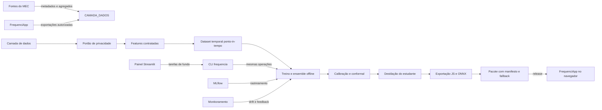
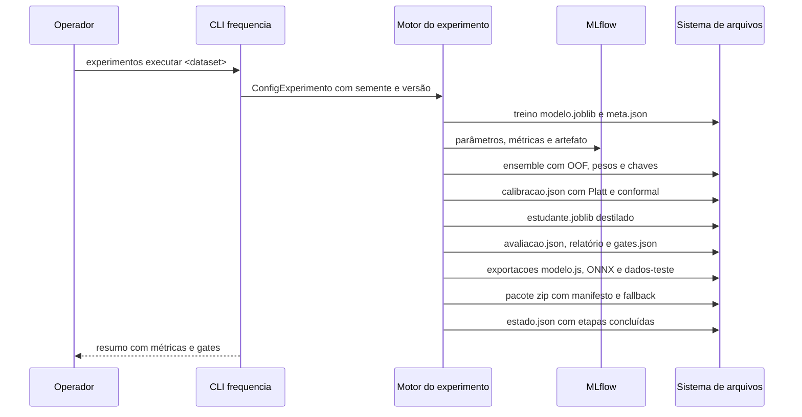

# Arquitetura

O FrequencIA é o motor de MLOps do FrequenciApp: um pacote Python 3.12 organizado em camadas, com uma CLI como interface primária e um painel Streamlit como janela de governança sobre o mesmo motor. O produto final é um artefato leve de inferência local no navegador.

## Visão geral

O ciclo começa em dados sintéticos ou importados, passa pelo portão de privacidade, vira dataset temporal com features contratadas, alimenta um ensemble offline que destila para um estudante leve, e termina num pacote zip com manifesto lido pelo PWA. Nenhum dado pessoal sai do dispositivo na inferência.

## Camadas e pastas

A estrutura física segue os domínios de implementação; as camadas conceituais do briefing (inclusive projetos e integração) existem como responsabilidades mapeadas, nem todas viram pastas de primeiro nível.

| Camada conceitual | Responsabilidade | Onde vive |
| --- | --- | --- |
| Infraestrutura | Caminhos, erros amigáveis, logs, hash, estado e auditoria | `src/frequencia/infra/` |
| Dados | Fontes MEC, esquemas, geração sintética, importação e perfil | `src/frequencia/dados/` |
| Segurança e privacidade | Detector de PII, portão de treino, pseudonimização e relatórios | `src/frequencia/privacidade/` |
| Features | Catálogo contratado, calendário, diário, cálculo e confiança | `src/frequencia/features/` |
| Pipelines | Dataset temporal, treino, ensemble, destilação, calibração, avaliação, exportação e experimento | `src/frequencia/pipelines/` |
| Projetos | Cartão, problema, métricas e plano de cada modelo | `projetos/risco-infrequencia/` |
| Avaliação transversal | Métricas, subgrupos, fairness, gates e relatórios | `src/frequencia/pipelines/avaliacao.py` |
| Modelos e registro | Registro de versões, estados, promoções e publicações | `src/frequencia/modelos/` |
| Distribuição | Manifesto de compatibilidade e montagem do pacote | `src/frequencia/distribuicao/` |
| Integração | Contrato de entrada e saída, mapa de features e mensagens | `src/frequencia/integracao/` |
| Monitoramento | Drift, validade, feedback e saúde | `src/frequencia/monitoramento/` |
| Testes | Cinco famílias mais paridade e guarda editorial | `tests/` |
| Automação | Smoke scripts, Makefile, pre-commit e compose | `scripts/`, `Makefile`, `.pre-commit-config.yaml` |
| Interfaces | CLI e painel web | `src/frequencia/cli/` e `src/frequencia/web/` |

## Fluxo de uma execução do ciclo

Cada etapa é idempotente: o estado em `var/artefatos/experimentos/<id>/estado.json` registra a conclusão e execuções seguintes pulam o que já foi feito, salvo `--forca` com justificativa auditada. O reaproveitamento vale só para a mesma configuração e o mesmo conteúdo de dataset: o estado guarda uma chave dos dois, e qualquer diferença invalida todas as etapas, com registro na auditoria. Quando uma etapa precisa rodar de novo, todas as seguintes também rodam, porque dependem dos artefatos dela.

## Diário ponto-in-tempo

O coração semântico do pipeline é a materialização do diário por aluno e dia como visível num instante do passado. As chamadas salvas com atraso não aparecem antes de serem salvas; faltas removidas por correção desaparecem dos snapshots posteriores; justificativas adicionadas depois entram só a partir da data da correção. A derivação da marca segue o documento soberano do FrequenciApp: FJ quando todas as faltas do dia têm justificativa, F quando falta em todas as aulas, S quando falta parcial no modo por aula, P quando estava na lista sem falta e vazia quando não havia chamada. Célula vazia é ausência de frequência, nunca presença.

## Confiança do produto

A saída publicada carrega quatro mecanismos de confiança: calibração de Platt regularizada em direção à identidade (o primeiro mês de dados não deforma a escala), encolhimento para a taxa base durante o aquecimento de 30 dias, intervalos conformes de Mondrian por série e faixa de histórico, e estados de confiança do produto (sem histórico, dados insuficientes, em observação, confiança moderada, confiança alta, modelo desatualizado). O alerta usa histerese: liga após dois dias acima do limiar de entrada e só desliga abaixo do limiar de saída, mais baixo.

## Decisões registradas

- [ADR-001: uso de polars como motor de dados](adr/001-uso-de-polars.md)
- [ADR-002: exportação via m2cgen com ONNX como alternativa](adr/002-exportacao-via-m2cgen.md)
- [ADR-003: calibração Platt regularizada e predição conforme](adr/003-calibracao-e-conformal.md)
- [ADR-004: pandera para validação de esquemas](adr/004-pandera-para-esquemas.md)
- [ADR-005: estrutura física por domínios com camadas mapeadas](adr/005-estrutura-fisica-e-camadas.md)
- [ADR-006: convenção híbrida de identificadores](adr/006-convencao-de-identificadores.md)
- [ADR-007: stack fixada com substituição por ADR](adr/007-stack-fixada.md)
- [ADR-008: MLflow com backend SQLite local](adr/008-mlflow-sqlite.md)
- [ADR-009: presidio em modo padrão reforçado por regras próprias](adr/009-presidio-modo-padrao.md)
- [ADR-010: DVC sem repositório Git](adr/010-dvc-sem-git.md)
- [ADR-011: verdade oculta no gerador sintético](adr/011-verdade-oculta-sintetica.md)
- [ADR-012: ensemble offline destilado para estudante leve](adr/012-ensemble-destilado.md)
- [ADR-013: atualização atômica do modelo no PWA](adr/013-atualizacao-atomica-pwa.md)
- [ADR-014: ponto-in-tempo estrito com purga temporal](adr/014-ponto-no-tempo-estrito.md)
- [ADR-015: registro de metadados em JSON com auditoria JSONL](adr/015-estado-json-auditoria.md)
