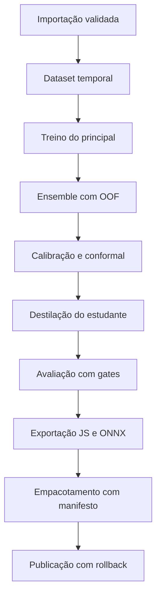

# MLOps: treinar, avaliar, calibrar e publicar

O ciclo completo do modelo de risco de infrequência, do dado ao pacote, com o que cada etapa produz e onde fica.

## Visão do ciclo



Tudo isso é um comando. No caminho padrão, use Docker:

```bash
docker compose --profile cli run --rm cli frequencia experimentos executar \
  var/dados/processados/<dataset> \
  --identificador <id>
```

As etapas rodam em ordem, cada uma grava artefato e estado, e reexecuções pulam o que concluiu. No fallback venv, ative o ambiente e troque o prefixo Docker por `frequencia`.

## Treino

O modelo principal é LightGBM com parâmetros declarativos (config/experimento.yaml ou opções de linha). O rastreamento vai ao MLflow com parâmetros, métricas e o artefato; a run id volta no resumo. Com `--tentativas N`, o Optuna faz busca leve de num_leaves, learning_rate, min_child_samples e reg_lambda sobre a divisão temporal, com TPE semeado.

## Ensemble

Sete membros com vistas diferentes (famílias de modelo e subconjunto curto de features), dobras temporais expansivas com previsões fora da dobra e purga do horizonte (os sete dias letivos antes de cada bloco de validação saem do treino da dobra), blending por regressão logística com pesos normalizados e registrados, discordância média como incerteza. Os membros finais são reajustados com treino mais validação e salvos em ensemble/ para reanálise.

## Calibração

Platt regularizado (lambda 0,5) sobre o blend fora da dobra, taxa base do rótulo, quantis conformes de Mondrian por série e faixa de histórico com nível 0,90, curva de aprendizado por volume de histórico. Resultado em calibracao.json com ECE antes e depois.

## Destilação

O estudante (LightGBM profundidade 3, 60 iterações) aprende os alvos suaves calibrados por duplicação ponderada (rótulo 1 com peso p; rótulo 0 com peso 1-p), que reproduz o gradiente esperado sem violar a restrição do wrapper sklearn a rótulos discretos. O tamanho do joblib fica em torno de 60 KB.

## Avaliação

Métricas globais (AUC, AP, logloss, Brier), precisão e revocação no Top-10 diário (a capacidade real da coordenação), taxa de alerta e falsos positivos no limiar, subgrupos por série e por faixa de histórico, fairness pela dispersão de revocação e taxa de alerta, estabilidade temporal por mês, comparação com o baseline de regras e gates objetivos. Saída em avaliacao.json, relatorio-avaliacao.md e gates.json.

## Exportação

O núcleo transpilado por m2cgen recebe o invólucro de confiança (calibração, aquecimento, conformal, estados, histerese) e vira modelo.js; o mesmo invólucro existe em Python para o teste de paridade. A validação roda o arquivo no Node com os casos sintéticos, mede latência e confere tamanho; o caminho ONNX exporta com opset 15 para consumidores não web.

## Empacotamento

O pacote zip carrega modelo.js, fallback.js, manifest.json, dados-teste.json, modelo-cartao.md, LEIA-ME.md e contexto-mec.json. O manifesto é montado e validado, os hashes de todos os arquivos entram nele, e a versão nasce registrada no estado experimental.

## Publicação

Promoção com papel de aprovador até homologado, publicação no canal local com notas e instruções, conferência de hash e compatibilidade, rollback e revogação disponíveis. Ver docs/publicacao-de-modelos.md.

## Rastreamento e reprodutibilidade

- MLflow com backend SQLite em var/mlflow, experimento frequencia, run por treinamento.
- Semente global (FREQUENCIA_SEMENTE ou opção de linha) em geração, treino, dobras e destilação.
- Hash SHA-256 da pasta de dados no meta do dataset e na linhagem; hash do modelo no registro.
- DVC em modo sem Git versiona a amostra com cache local.

## Automação

O Makefile usa Docker por padrão e expõe setup, up, smoke, test, lint, tipo, formato, demo e limpar; os alvos `venv-*` são fallback. O compose traz mlflow, app, cli e o perfil de ciclo smoke. O pre-commit roda ruff e a guarda editorial a cada commit. O volume `dados` do Docker é separado do `var/` local do venv; registre o caminho usado no experimento.
